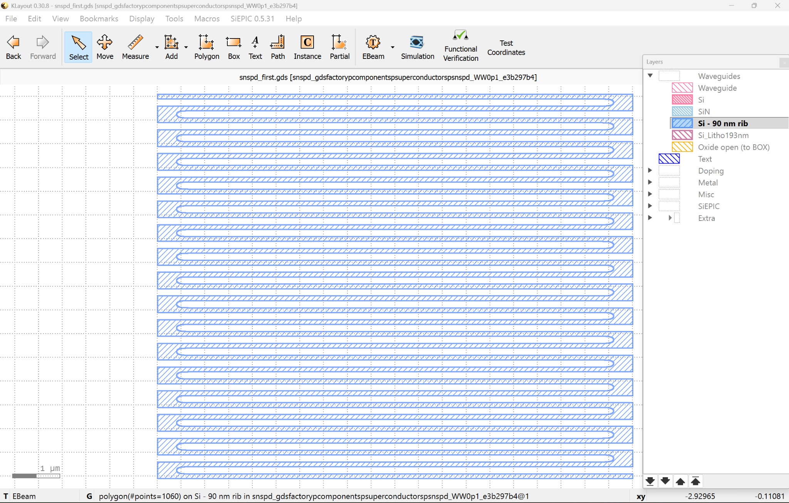
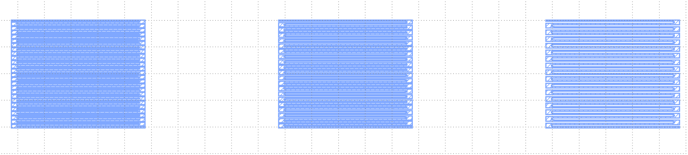
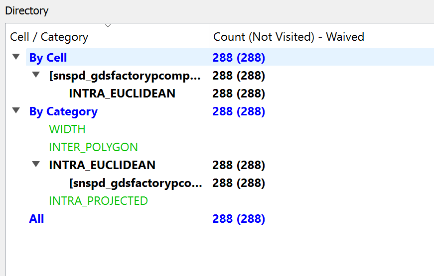
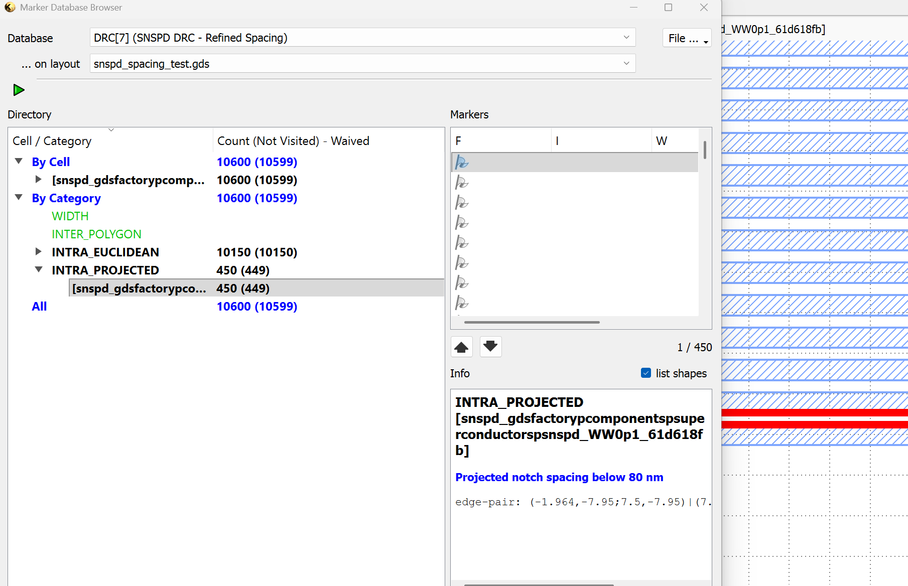

# SNSPD Parametric Layout & DRC Demonstration

A compact **Python → parameter sweep → hierarchical GDSII → KLayout DRC** demonstration using gdsfactory. The exercise explores geometric design choices for superconducting nanowire single-photon detectors (SNSPDs), including nanowire width, pitch, and the effect of minimum-width and minimum-spacing constraints.

> **Scope:** In this educational layout-automation and verification example (not fabricated, & experimentally characterized, or foundry-qualified SNSPD) all design-rule thresholds are illustrative. No superconducting performance, optical absorption, switching-current, or yield claims are made.

## Workflow

1. Define `wire_width` and `wire_pitch` combinations in Python.
2. Generate meander SNSPD cells with `gf.components.snspd()`.
3. Add cell references to a hierarchical parent layout and export GDSII.
4. Pre-screen geometries against **hypothetical** 90 nm minimum-width and 80 nm minimum-spacing thresholds.
5. Inspect the GDS in KLayout and compare Euclidean and projected notch checks.
6. Generate a deliberate 60 nm gap to confirm that the projected notch check reports a known violation.

## Layout examples

**Single meander:**



**Three pitch variants:** An earlier one-parameter sweep generated and inspected in KLayout.



The accompanying `src/snspd_sweep.py` generates a **3 × 3** sweep of nine width/pitch combinations. It also produces a second, pre-screened GDS containing only the four variants passing both illustrative parameter thresholds. The nine-device screenshot is not included; regenerate the layout locally to inspect it.

### Width × pitch parameter matrix

All dimensions below are in **nanometres**. The number in parentheses is the nominal straight-section edge-to-edge gap, `pitch − width`.

| Width / pitch | 160 | 200 | 250 |
|---|---|---|---|
| 80 | Reject (80) — width too small | Reject (120) — width too small | Reject (170) — width too small |
| 100 | Reject (60) — spacing too small | **Pass (100)** | **Pass (150)** |
| 120 | Reject (40) — spacing too small | **Pass (80)** | **Pass (130)** |

**4 of 9** combinations pass these two parameter checks. **Passing does not imply GDS-level DRC sign-off**, especially around curved turns and electrical contacts.

## DRC experiment: observed KLayout results

The user-generated layout on GDS layer **(2, 0)** was tested with `drc/snspd_spacing_diagnostic.lydrc` using a hypothetical **80 nm** minimum-gap requirement.

| Test layout | Width violations | Inter-polygon spacing | Euclidean same-polygon notch | Projected same-polygon notch |
|---|---:|---:|---:|---:|
| Reference: width 100 nm, pitch 250 nm (nominal gap 150 nm) | 0 | 0 | 288 | 0 |
| Deliberately invalid: width 100 nm, pitch 160 nm (nominal gap 60 nm) | 0 | 0 | 10,150 | 450 |

The difference between Euclidean and projected notch results illustrates why the **distance metric and local polygon geometry must be reviewed**, particularly around curved meander turns approximated by short polygon segments. The test confirms that the projected rule detects the deliberately narrowed straight-section gaps. It does **not** demonstrate that all 288 Euclidean markers are harmless or that the reference layout is manufacturable.

**Reference DRC comparison:**



**Deliberately introduced spacing violation:**



## Run locally

Requirements: Python, gdsfactory (compatible API), and KLayout for viewing and DRC. A working environment used the gdsfactory **generic PDK**, not an SNSPD foundry PDK.

```bash
python -m pip install -r requirements.txt
python src/snspd_sweep.py
python src/snspd_spacing_test.py
```

Open the generated files from `gds/` in KLayout. To run the DRC demonstration, open the layout and execute `drc/snspd_spacing_diagnostic.lydrc` using KLayout's DRC scripting environment. Inspect the marker locations and categories rather than relying only on the total count.

Generated GDS files are excluded from this source archive and can be regenerated with the provided scripts. If distributing a frozen mask-layout snapshot, add the generated GDS separately and include tool-version information.

## Technology and verification boundaries

- **GDS layer (2, 0) is arbitrary in this demonstration.** An EBeam technology display can label it as a silicon rib layer; that does **not** make the design a silicon or superconducting foundry device.
- **Neither the generic gdsfactory PDK nor the SiEPIC EBeam PDK provides SNSPD foundry qualification** for this design. Different technologies require their own layer maps, minimum dimensions, bend rules, contact rules, extraction, and release procedures.
- The code has no calibrated superconducting models, optical-mode simulations, electrical terminals/readout routing, LVS verification, wafer test structures, experimental characterization, or production mask sign-off.
- A production SNSPD PDK would additionally require validated material/layer information, parameterized devices, full geometric and connectivity rules, regression tests, characterization feedback, and documented tape-out constraints.

## Repository structure

```text
SNSPD-Parametric-Layout-Design/
├── README.md
├── requirements.txt
├── .gitignore
├── src/
│   ├── snspd_sweep.py
│   └── snspd_spacing_test.py
├── drc/
│   └── snspd_spacing_diagnostic.lydrc
├── images/
│   ├── single_meander_klayout.png
│   ├── three_pitch_variants_klayout.png
│   ├── original_drc_comparison.png
│   └── deliberate_spacing_violation.png
└── gds/
    └── .gitkeep  # Output files generated locally
```

**Tools:** Python · gdsfactory · KLayout · GDSII · demonstration DRC.
